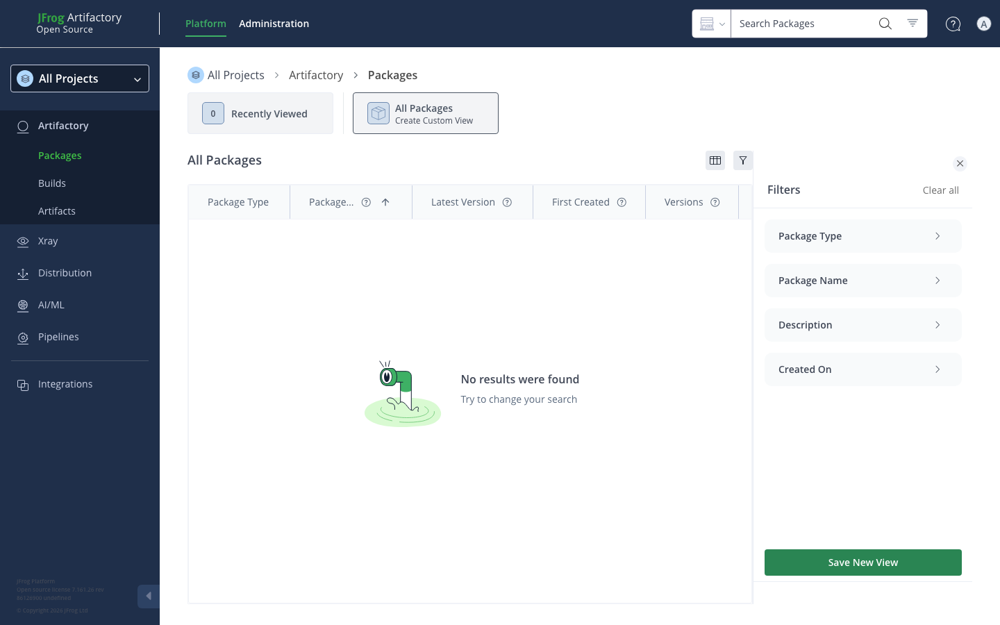

# Вход в Artifactory и смена пароля

## Первый вход и настройка

На локальном стенде выполнен вход под `admin`. В мастере первичной настройки на шаге `Reset Admin Password` задан новый пароль администратора.

Настройку `Base URL`, прокси и создание репозиториев пропустил кнопкой `Skip`. После сообщения об успешном завершении настройки нажал `Finish`.

## Проверка повторного входа

Вышел из Artifactory и снова вошёл под `admin` с новым паролем. Открылась страница `Packages`. В верхней панели видны `Platform` и `Administration`.

# Задание 3. Вход в интерфейс и смена пароля

**Что делаем:** заходим в веб-интерфейс Artifactory и меняем пароль
администратора.

## Шаг 1. Откройте интерфейс

В браузере: http://localhost:8082

Появится страница входа JFrog (зелёный логотип-лягушка).

## Шаг 2. Войдите

- Username: `admin`
- Password: `password`

## Шаг 3. Пройдите мастер первичной настройки

1. Мастер попросит задать **новый пароль** администратора. Придумайте
   и **обязательно запишите** — он нужен во всех следующих заданиях.
2. Остальные шаги мастера можно пропустить (Skip): base URL оставляем
   как есть, прокси не настраиваем, репозитории создадим сами в задании 4.

## Шаг 4. Проверьте, что попали внутрь

Должен открыться главный экран Artifactory. Слева меню, сверху переключение
между **Application** (работа с артефактами) и **Administration**
(настройки, иконка шестерёнки).

## Результат

Вы вошли под admin и сменили пароль.

**В отчёт:** скриншот главного экрана.

> Всё, что дальше написано как `-u admin:ВАШ_ПАРОЛЬ` или `PASSWORD="____"`,
> использует именно этот новый пароль.
