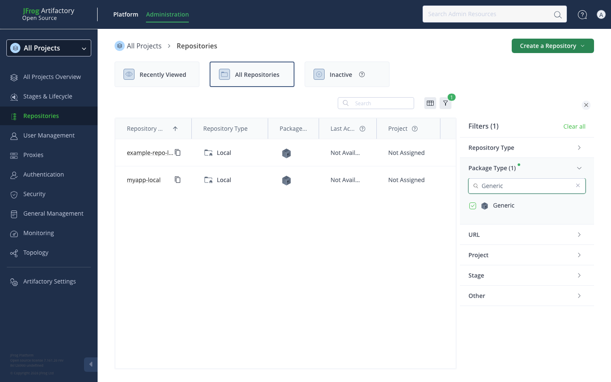

# Создание репозитория myapp-local

## Создание через веб-интерфейс

Открыл `Administration → Repositories` и выбрал `Create a Repository → Local`. Указал тип пакетов `Generic`, ввёл `myapp-local` в поле `Repository Key` и нажал `Create Local Repository`.

Artifactory подтвердил создание сообщением `myapp-local was created successfully`.

## Проверка в списке

После обновления страницы репозиторий сохранился в списке. На скриншоте `myapp-local` отображается как `Local` при выбранном фильтре типа пакетов `Generic`.



<div><hr></div>

# Задание 4. Создание репозитория в интерфейсе

**Что делаем:** создаём свой репозиторий `myapp-local` — «полку», куда
будем складывать артефакты.

**Зачем:** репозиторий — основная единица хранения в Artifactory.
Тип `local` означает «наши собственные файлы», формат `Generic` —
«любые файлы».

## Шаг 1. Откройте раздел репозиториев

Вверху нажмите на иконку шестерёнки (**Administration**) →
в меню слева **Repositories** → справа кнопка **Add Repositories** →
**Local Repository**.

## Шаг 2. Выберите тип пакетов

В списке типов выберите **Generic** (самый простой — хранит любые файлы).

## Шаг 3. Задайте имя

В поле **Repository Key** впишите:

```
myapp-local
```

Это имя войдёт в URL, поэтому только латиница, без пробелов.

## Шаг 4. Сохраните

Нажмите **Save & Finish** (или **Create Local Repository**).

В списке репозиториев должна появиться строка `myapp-local`.

## Результат

Репозиторий `myapp-local` создан и виден в списке.

**В отчёт:** скриншот списка репозиториев.

> Заметьте: в списке уже был `example-repo-local` — демонстрационный
> репозиторий из коробки.
