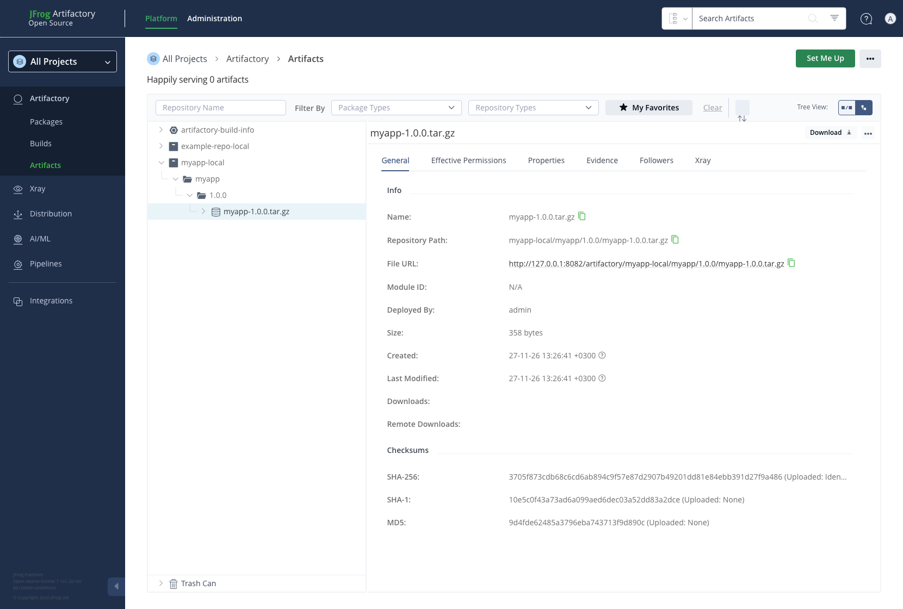

# Артефакт myapp 1.0.0 в интерфейсе Artifactory

## Поиск в дереве

Открыл `Platform → Artifactory → Artifacts` и раскрыл `myapp-local → myapp → 1.0.0`. В карточке файла `myapp-1.0.0.tar.gz` на вкладке `General` видны размер 358 байт и пользователь `admin`. В поле `Created` указано `27-11-26 13:26:41 +0300`.

## Сверка контрольной суммы

В разделе `Checksums` значение `SHA-256` совпало с ответом API из задания 7. Artifactory показал статус `Uploaded: Identical`.

```text
3705f873cdb68c6cd6ab894c9f57e87d2907b49201dd81e84ebb391d27f9a486
```



<div><hr></div>

# Задание 8. Находим артефакт в интерфейсе

**Что делаем:** смотрим на опубликованный файл глазами — в веб-интерфейсе.

## Шаг 1. Откройте дерево артефактов

В браузере (http://localhost:8082) сверху выберите **Application**
(иконка кубика) → слева **Artifactory** → **Artifacts**.

## Шаг 2. Пройдите по дереву

Раскройте: `myapp-local` → `myapp` → `1.0.0` → `myapp-1.0.0.tar.gz`.

## Шаг 3. Посмотрите свойства файла

Кликните на файл. Справа откроется панель с информацией:
- размер, кто загрузил (`admin`), когда;
- вкладка **Checksums** — контрольные суммы SHA-256, SHA-1, MD5.

Сравните SHA-256 на экране с тем, что вернул сервер в задании 7.

## Результат

Файл виден в дереве, контрольная сумма в UI совпадает с суммой
из ответа API.

**В отчёт:** скриншот панели файла с контрольными суммами.
